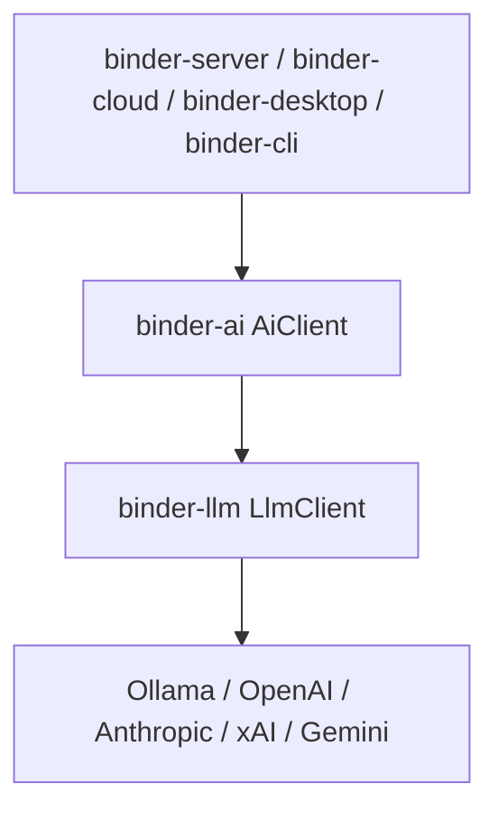

# binder-ai as-built

`binder-ai` is a Rust library. `AiClient` is the only type applications should construct.

## Request path

1. Map the call to a `Task` / `AiRequest`.
2. Resolve a named prompt (versioned) and compose context (conversation, repo, diff, issue, …).
3. Router selects a model from policy, capabilities, and availability.
4. `providers` builds an `LlmClient` (or uses an injected test client).
5. Tool loop: model → registry → executor → tool result → model.
6. Semantic retries, then fallback to the next provider.
7. Record usage, estimated cost, and tracing metadata (never prompt text).

Infrastructure HTTP retries stay in `binder-llm`.
