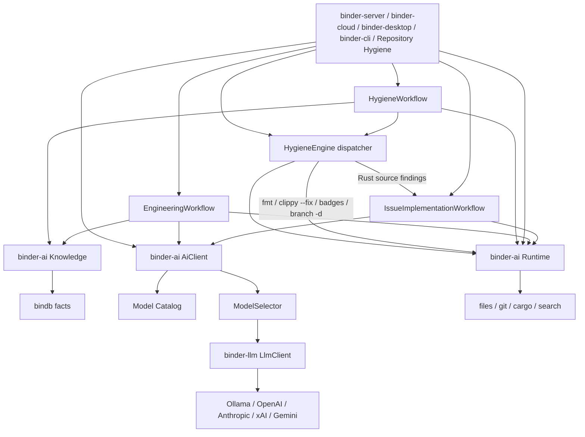

# binder-ai as-built

`binder-ai` is a Rust library. Applications construct [`AiClient`] for model work and [`Runtime`] for the development environment. They do not call `binder-llm` or touch the filesystem directly from workflows.

## Request path

1. Map the call to a `Task` / `AiRequest`.
2. Resolve a named prompt (versioned) and compose context (conversation, repo, diff, issue, …).
3. Build `ModelRequirements` from task defaults plus request policy / cost / preference.
4. `CatalogSelector` filters by availability, execution policy, capabilities, context window, cost, and quality, then scores the rest.
5. `providers` builds an `LlmClient` (or uses an injected test client).
6. Tool loop: model → registry → executor → tool result → model.
7. Semantic retries, then fallback to the next catalog target. `LocalOnly` / `Private` never include cloud targets.
8. Record `AiUsage`, estimated cost, and tracing metadata (never prompt text).

Infrastructure HTTP retries stay in `binder-llm`.

## Catalog merge

Effective catalog = builtin TOML metadata + Ollama discovery (`list_models`) + user TOML overlays + which providers have credentials (or were injected in tests).

`AiClient::builder().build()` builds that effective catalog during construction:

1. Start from the configured catalog (builtin or injected TOML).
2. Mark providers without credentials (or not in `available_providers`) Unavailable.
3. Discover installed Ollama models via `binder-llm` `list_models`.
4. Mark installed local models Available; mark missing configured local models Unavailable.
5. Add unknown installed names with prefix-profile metadata, or conservative defaults.

The router never scores the raw configured catalog. Unavailable models are not selectable unless an explicit model override is set. Local model-not-found (Ollama 404) is an availability failure and falls back to the next candidate.

## Runtime

`Runtime` owns files, search, structured commands, and git. It does not own routing, prompts, or tool calling. Workflows depend on the trait:

1. `search` / `read_file`
2. `AiClient::execute` (reasoning)
3. `write_file`
4. `execute(cargo fmt)` / `execute(cargo test)` — argv only, never a shell string
5. `git_diff`

`LocalRuntime` is the development implementation (`tokio::fs`, `tokio::process::Command`, `git2`, `ignore` search). `MemoryRuntime` is the test implementation (in-memory files, scripted commands). Docker/SSH/sandbox runtimes are out of scope until the trait has been used by real workflows.

## EngineeringWorkflow

Concrete bindb-first sequence: `Knowledge::plan` / `doctrine` → read **only** inspection-set paths via `Runtime` → plan JSON via `AiClient` → file edits via `AiClient` → write allowed paths → `cargo fmt` / `cargo test` → `git_diff` → `Knowledge::reindex` on success. Tests use `MemoryRuntime`, `MemoryKnowledge`, and `MockAiClient`. Search is not used.

## IssueImplementationWorkflow

Concrete sequence, not a framework: search and read via `Runtime` **or** read a supplied inspection set (no search) → plan JSON via `AiClient` → file edits via `AiClient` → `write_file` → `cargo fmt` / `cargo test` via structured `Command` → `git_diff`. Tests use `MemoryRuntime` and `MockAiClient`.

## HygieneWorkflow

Bindb-first Hygiene POC: `Knowledge::doctrine` / `plan` → existing finding dispatch → binder-llm only for AI findings with the inspection set as file context (`IssueImplementationRequest::inspection_set`) → validate → `Knowledge::reindex` → `Knowledge::record_execution`. Deterministic fmt/clippy/badge/branch-delete skip the LLM. `Runtime::search` is not used. Dashboard `HygieneEngine::process_findings` is unchanged.

## HygieneEngine

Repository Hygiene inspects dashboards, branches, PRs, CI, cargo, and git **without** AI. It classifies typed `Finding`s, then `HygieneEngine` dispatches:

- Deterministic: `git branch -d`, `cargo fmt`, `cargo clippy --fix`, README CI badge
- Report-only: dirty trees, open PRs, broken pipelines, stale branches, unknown, non-Rust projects
- AI (`AutoRemediation::RustImplementation` only): missing tests, Rust bugs, rustdoc in `.rs` files on Cargo projects → `IssueImplementationWorkflow`

Production construction is `AiClient::builder().routing_policy(RoutingPolicy::LocalOnly).build()` (default catalog discovery, no hardcoded model) plus `LocalRuntime` rooted at the inspected repo. Hygiene validates workflow success, fmt, tests, and a non-empty git diff. Failures are recorded with no retry; remaining repositories continue. The engine never commits, merges, pushes, or opens a PR.
