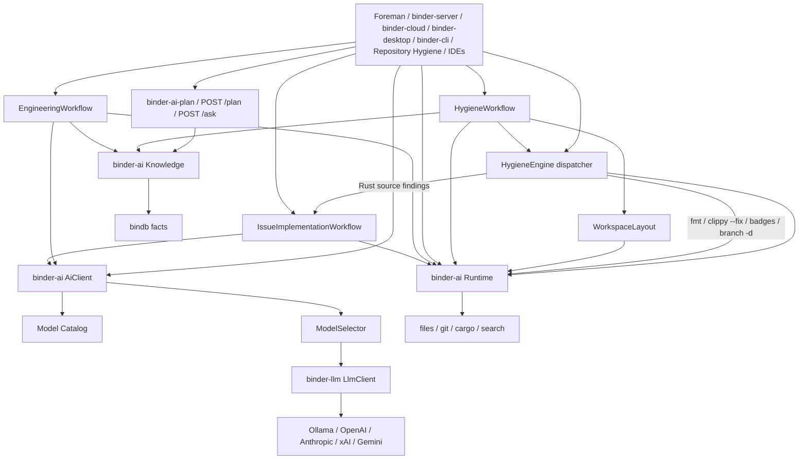
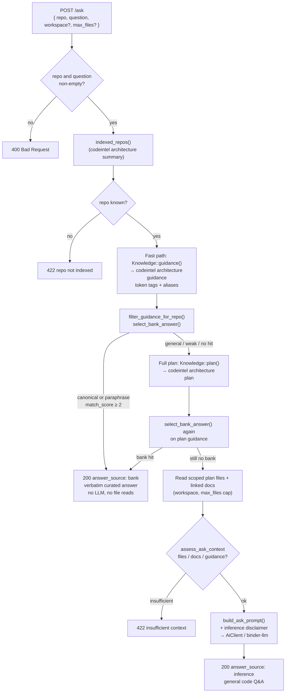

# binder-ai as-built

`binder-ai` is a Rust library. Applications construct [`AiClient`] for model work and [`Runtime`] for the development environment. They do not call `binder-llm` or touch the filesystem directly from workflows.

## Request path

1. Map the call to a `Task` / `AiRequest`.
2. Resolve a named prompt (versioned) and compose context (conversation, repo, diff, issue, …).
3. Build `ModelRequirements` from task defaults plus request policy / cost / preference.
4. `CatalogSelector` filters by availability, execution policy, capabilities, context window, cost, and quality, then scores the rest.
5. `providers` builds an `LlmClient` (or uses an injected test client).
6. Tool loop: model → registry → executor → tool result → model.
7. Semantic retries, then fallback to the next catalog target. `LocalOnly` / `Private` never include cloud targets.
8. Record `AiUsage`, estimated cost, and tracing metadata (never prompt text).

Infrastructure HTTP retries stay in `binder-llm`.

## Catalog merge

Effective catalog = builtin TOML metadata + Ollama discovery (`list_models`) + user TOML overlays + which providers have credentials (or were injected in tests).

`AiClient::builder().build()` builds that effective catalog during construction:

1. Start from the configured catalog (builtin or injected TOML).
2. Mark providers without credentials (or not in `available_providers`) Unavailable.
3. Discover installed Ollama models via `binder-llm` `list_models`.
4. Mark installed local models Available; mark missing configured local models Unavailable.
5. Add unknown installed names with prefix-profile metadata, or conservative defaults.

The router never scores the raw configured catalog. Unavailable models are not selectable unless an explicit model override is set. Local model-not-found (Ollama 404) is an availability failure and falls back to the next candidate.

## Runtime

`Runtime` owns files, search, structured commands, and git. It does not own routing, prompts, or tool calling. Workflows depend on the trait:

1. `search` / `read_file`
2. `AiClient::execute` (reasoning)
3. `write_file`
4. `execute(cargo fmt)` / `execute(cargo test)` — argv only, never a shell string
5. `git_diff`

`LocalRuntime` is the development implementation (`tokio::fs`, `tokio::process::Command`, `git2`, `ignore` search). `MemoryRuntime` is the test implementation (in-memory files, scripted commands). Docker/SSH/sandbox runtimes are out of scope until the trait has been used by real workflows.

## EngineeringWorkflow

Concrete bindb-first sequence: `intel::plan` / doctrine → if `fallback_required` then explicit `Runtime::search`, else read **only** inspection-set paths → plan JSON via `AiClient` → file edits via `AiClient` → write allowed paths → `cargo fmt` / `cargo test` → `git_diff` → `Knowledge::reindex` on success. Tests use `MemoryRuntime`, `MemoryKnowledge`, and `MockAiClient`. Search is not used when the plan is `resolved`.

## IssueImplementationWorkflow

Concrete sequence, not a framework: search and read via `Runtime` **or** read a supplied inspection set (no search) → plan JSON via `AiClient` → file edits via `AiClient` → `write_file` → `cargo fmt` / `cargo test` via structured `Command` → `git_diff`. Tests use `MemoryRuntime` and `MockAiClient`.

## HygieneWorkflow

Apply path only. Findings and `OperationalContext` come from the scanner / dashboard / skill. bindb `Knowledge::plan` runs only for AI findings and returns location-independent semantic targets (`repo:path`). `HygieneWorkflow` resolves those into the execution workspace (`WorkspaceLayout`, `hygiene_apply --workspace` / `--bind`) before binder-llm. Unresolved targets fail as `workspace_resolution` with no mutation and no re-index. Deterministic fmt/clippy/badge/branch-delete skip the LLM. Branch delete uses the same PR-head / dirty-checkout guards as dashboard hygiene. README badge reads the live file. After validation: `reindex` of the **execution** checkouts + `record_execution`. Production knowledge: `CodeintelKnowledge`. Tests: `MemoryKnowledge`. `Runtime::search` is not used. Dashboard `HygieneEngine::process_findings` and Python `run_hygiene` are unchanged. The Cursor skill apply adapter is `src/bin/hygiene_apply.rs` plus `SkillApplyDocument` JSON. Live Ollama uses `OLLAMA_HOST`.

`record_execution` appends `<store-path>.hygiene-history.jsonl` (sibling of the store directory via `Path::with_extension`). The store parent must be writable.

## Foreman software runtime

Foreman ExecutionOrchestrator invoke maps WorkItem kind `hygiene` → `hygiene_apply` and `documentation_review` → `documentation_review`. It does not embed `AiClient`. Checkout, git push, and PR create stay in Foreman. Operator topology: `foreman/docs/deployment/01-engineering-runtime-as-built.md`.

## Engineering intelligence (`binder-ai-plan` / `POST /plan`)

`binder-ai-plan` (one-shot) and `binder-ai-serve` (`POST /plan`) answer planning requests from IDEs. They query `Knowledge::plan`, classify `planning_result` / `fallback_required`, optionally resolve `repo:path` into the provided `workspace`, and return JSON. They do not call a model, write files, or re-index. Clients open only `resolved_execution_paths` when the plan is resolved. Repository discovery is allowed only when `fallback_required` is true. The CLI omits store-wide `doctrine` so IDE prompts stay small. `EngineeringWorkflow` uses this same `plan` and searches only after an explicit fallback.

### Two stores (binder-workspace#154)

There are two independent bindb stores with different membership:

| Store | Location | Population |
|---|---|---|
| **Laptop** | `$BINDER_AI_WORKSPACE/codeintel/store` | Full index set (42 repos): all git checkouts + `repo-dashboard` prefix tree + `codev` submodule. Populated by `index-bindb` CLI in `repo-dashboard`. |
| **QA** | `/data` PVC on `binder-ai-serve` pod | Subset: 41 `dpkimball/` GitHub repos (shallow clone + index) + `repo-dashboard` prefix-indexed from `binder-workspace` umbrella clone. Seed generation controlled by `dpk-infra` chart `seed.generation`. |

`scripts/binder-plan` without `BINDER_AI_PLAN_URL` uses the laptop store. With `BINDER_AI_PLAN_URL=http://192.168.86.47:31784` it queries the QA serve pod. The QA store uses `BINDER_AI_WORKSPACE=/data/workspace` so paths resolve as `<repo>/relative` without laptop SSD mounts. Laptop paths (`/Volumes/SSD/…`) are not valid on the pod.

## Engineering Q&A (`POST /ask`)

`binder-ai-serve` exposes `POST /ask` for repo-scoped questions against the question bank and bindb store. Spec: [`specs/016-question-bank-ask-quality.md`](https://github.com/dpkimball/binder-workspace/blob/master/specs/016-question-bank-ask-quality.md) (binder-workspace).

Handler: `execute_ask` in `src/bin/binder_ai_serve.rs`.

### Question shapes (what happens)

| Asker intent | Example | Path |
|--------------|---------|------|
| **Canonical bank question** | `"What belongs in codeintel vs bindb?"` | Token overlap ≥ `GUIDANCE_ASK_MIN_SCORE` (2) on a repo-prefix row → **`bank`**, no LLM |
| **Similar / paraphrased** | `"where does codeintel stop and bindb start?"` or an **alias** of C7 | Same retrieval: tags + aliases score into `match_score`. If ≥ 2 → **`bank`** (verbatim curated answer). Response may set `matched_alias` when an alias beat the canonical wording |
| **General code question** | `"How do I configure Kafka streaming?"` (no bank row) | No bank hit → full **`plan()`**, read scoped files/docs, then **LLM** → **`inference`**. Prompt warns: no authoritative bank row |
| **No bindb foothold** | Known repo but unresolved plan and no files/docs/guidance | **422** — refuse rather than invent |
| **Unknown repo** | `"nonexistent-repo-xyz"` | **422** before plan |

There is **no** dedicated “find similar questions” API. Similarity is only the bank matcher (token tags + aliases). Weak overlaps (score 1) stay on the **inference** path so a vaguely related bank row is not treated as authoritative.

**Bank short-circuit:** `select_bank_answer` requires a **repo-prefix** row (e.g. `C*` for codeintel) with `match_score ≥ 2`. Cross-repo `X*` never alone yields `answer_source: bank` for prefix-mapped repos. Guidance-first skips `read_plan_files` entirely.

**codeintel subprocess:** `CodeintelKnowledge` shells out to `codeintel architecture --store …` for `guidance`, `plan`, and `summary`. Question-bank rows live in bindb; `index-questions` on QA runs during store-refresh (see dpk-infra `binder-ai-serve` chart).

## HygieneEngine

Repository Hygiene inspects dashboards, branches, PRs, CI, cargo, and git **without** AI. It classifies typed `Finding`s, then `HygieneEngine` dispatches:

- Deterministic: `git branch -d`, `cargo fmt`, `cargo clippy --fix`, README CI badge
- Report-only: dirty trees, open PRs, broken pipelines, stale branches, unknown, non-Rust projects
- AI (`AutoRemediation::RustImplementation` only): missing tests, Rust bugs, rustdoc in `.rs` files on Cargo projects → `IssueImplementationWorkflow`

Production construction is `AiClient::builder().routing_policy(RoutingPolicy::LocalOnly).build()` (default catalog discovery, no hardcoded model) plus `LocalRuntime` rooted at the inspected repo. Hygiene validates workflow success, fmt, tests, and a non-empty git diff. Failures are recorded with no retry; remaining repositories continue. The engine never commits, merges, pushes, or opens a PR.
