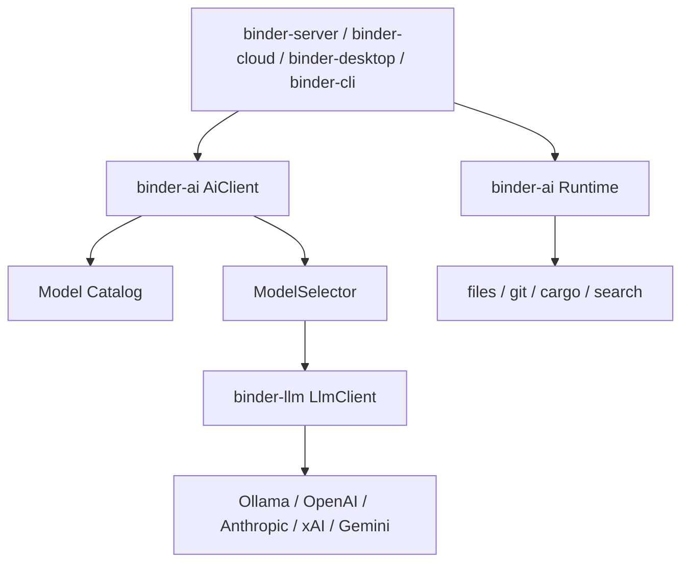

# binder-ai as-built

`binder-ai` is a Rust library. Applications construct [`AiClient`] for model work and [`Runtime`] for the development environment. They do not call `binder-llm` or touch the filesystem directly from workflows.

## Request path

1. Map the call to a `Task` / `AiRequest`.
2. Resolve a named prompt (versioned) and compose context (conversation, repo, diff, issue, …).
3. Build `ModelRequirements` from task defaults plus request policy / cost / preference.
4. `CatalogSelector` filters by availability, execution policy, capabilities, context window, cost, and quality, then scores the rest.
5. `providers` builds an `LlmClient` (or uses an injected test client).
6. Tool loop: model → registry → executor → tool result → model.
7. Semantic retries, then fallback to the next catalog target. `LocalOnly` / `Private` never include cloud targets.
8. Record `AiUsage`, estimated cost, and tracing metadata (never prompt text).

Infrastructure HTTP retries stay in `binder-llm`.

## Catalog merge

Effective catalog = builtin TOML metadata + Ollama discovery (`list_models`) + user TOML overlays + which providers have credentials (or were injected in tests).

## Runtime

`Runtime` owns files, search, structured commands, and git. It does not own routing, prompts, or tool calling. Workflows depend on the trait:

1. `search` / `read_file`
2. `AiClient::execute` (reasoning)
3. `write_file`
4. `execute(cargo fmt)` / `execute(cargo test)` — argv only, never a shell string
5. `git_diff`

`LocalRuntime` is the development implementation (`tokio::fs`, `tokio::process::Command`, `git2`, `ignore` search). `MemoryRuntime` is the test implementation (in-memory files, scripted commands). Docker/SSH/sandbox runtimes are out of scope until the trait has been used by real workflows.
